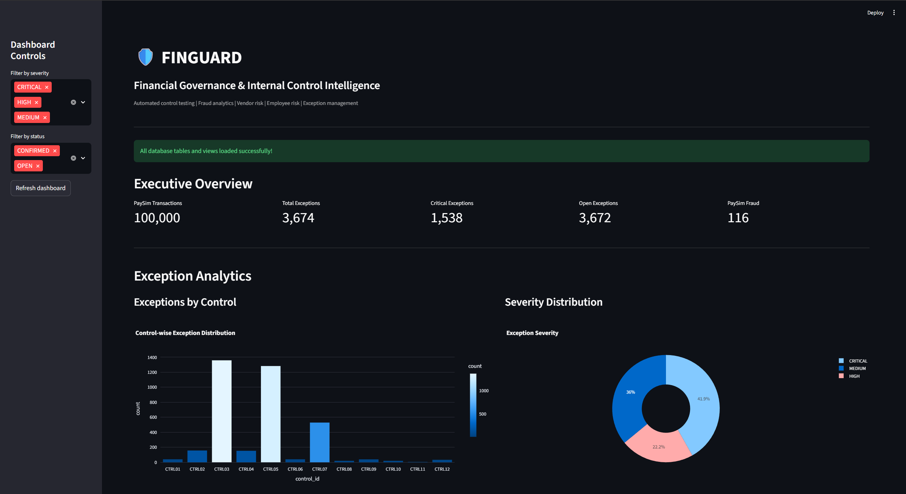
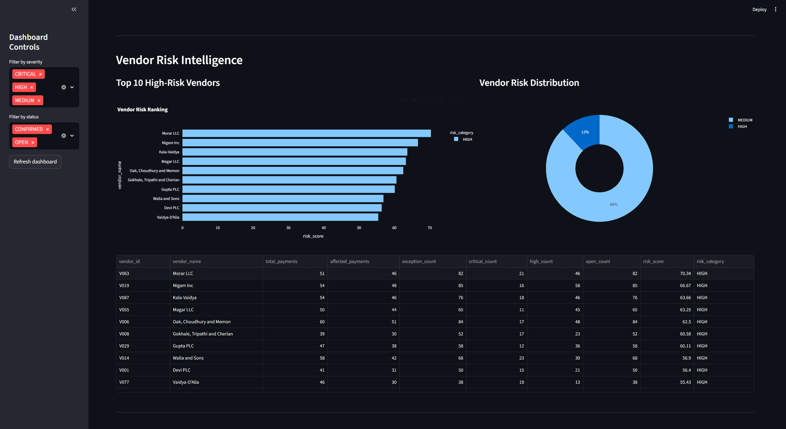
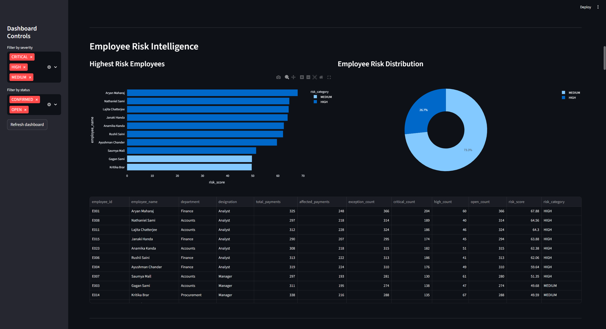
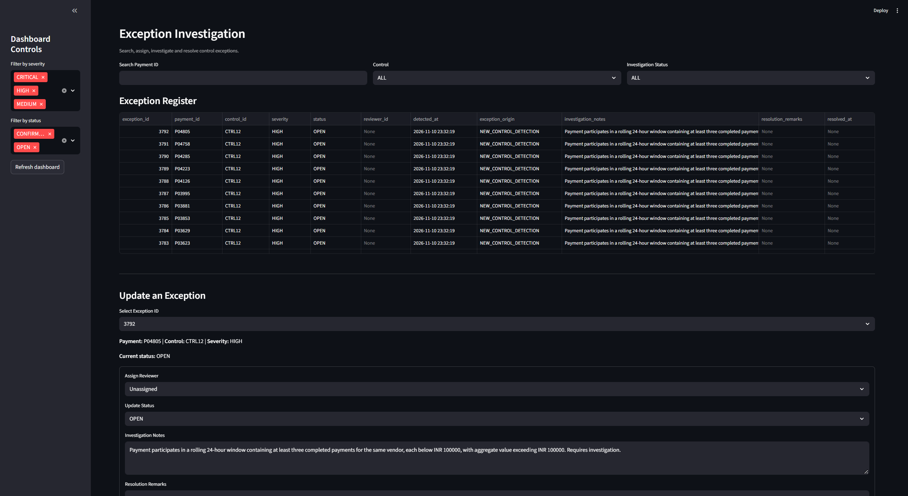
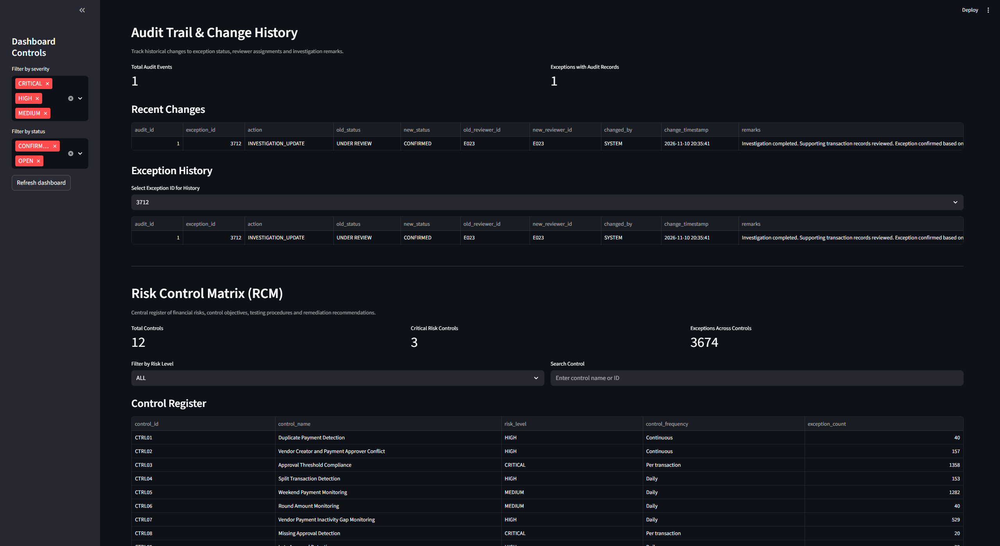
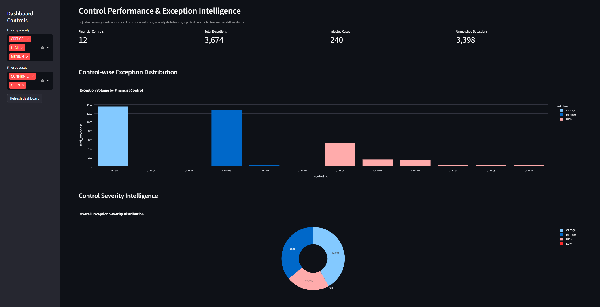
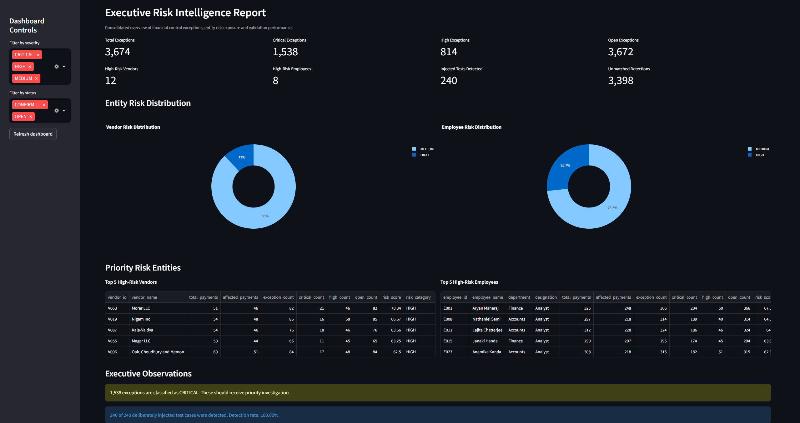

# FinGuard
### Financial Governance, Risk & Internal Controls Analytics Platform

FinGuard is a financial risk intelligence platform designed to identify potential payment anomalies, evaluate internal control exceptions, assess vendor and employee risk exposure, and support structured investigation workflows.

Built using Python, PostgreSQL, SQL and Streamlit, the platform combines rule-based financial monitoring with risk analytics and audit-trail capabilities.

## Key Features

- **12 Financial Controls:** SQL-based monitoring for duplicate payments, approval breaches, split transactions, maker-checker conflicts and vendor anomalies.
- **Risk Intelligence:** Vendor, employee, payment creator and approver risk profiling.
- **Exception Management:** Exception tracking, reviewer assignment, investigation notes and resolution workflows.
- **Audit Trail:** Transactional logging of exception status and reviewer changes.
- **Risk Control Matrix:** Centralized documentation of control objectives, risk descriptions, testing procedures and recommended actions.
- **Executive Dashboard:** Interactive visualizations, exception analytics and risk reporting.
- **Fraud Analytics:** PaySim transaction analysis using a dataset of 100,000 transactions.

## Dashboard Preview

### Executive Overview


### Vendor Risk Intelligence


### Employee Risk Intelligence


### Exception Investigation


### Audit Trail & Change History


### Control Performance & Exception Intelligence


### Executive Risk Report


## Control Library & Documentation

FinGuard includes a documented library of 12 financial risk and internal-control checks.

| Documentation | Description |
|---|---|
| [Risk Control Library](docs/control_library.md) | Definitions, objectives and detection logic for all 12 controls |
| [Control Reconciliation](docs/reconciliation.md) | Validation findings, data-quality observations and known discrepancies |

## Validation Results

The current validation results are based on the synthetic project dataset.

| Validation Metric | Result |
|---|---:|
| Automated QA checks | 40/40 passed |
| Control presence checks | 12/12 passed |
| Seeded test cases detected | 240/240 |
| Duplicate payment-control exception pairs | 0 |
| Total recorded exception records | 3,674 |

**Important:** Detection of all 240 seeded cases demonstrates coverage of the injected test scenarios. It does not establish production fraud-detection accuracy, precision or recall.

The exception population includes 3,398 detections unmatched to injected test cases. These remain unreviewed and should not automatically be classified as false positives.

## Exception Interpretation

The 3,674 exception records have the following origins:

| Exception Origin | Count |
|---|---:|
| Injected test cases | 240 |
| Unmatched detections | 3,398 |
| New control detections | 36 |
| **Total** | **3,674** |

The exception count represents payment-control records, not necessarily unique payments. A single payment may trigger multiple controls.

CTRL03 and CTRL05 account for a substantial proportion of the recorded exceptions. Their high detection volumes are documented as synthetic-data calibration and contextual-risk considerations.

See [Control Reconciliation](docs/reconciliation.md) for the detailed findings.

## Known Limitations

- The platform uses synthetic financial transaction data.
- Invoice-level identifiers are unavailable, so duplicate-payment detections are potential matches rather than confirmed duplicate invoices.
- Approval-limit breach results are influenced by synthetic payment amounts and configured employee approval limits.
- Weekend payment activity requires business-calendar context before being treated as a policy exception.
- Late-approval analysis uses payment date as a timing reference.
- Investigation audit records currently use `SYSTEM` as the actor rather than authenticated user identities.
- Unmatched detections require investigation before being classified as confirmed violations or false positives.

## Project Structure

```text
FinGuard_Final/
├── dashboard/
├── data/
├── docs/
│   ├── control_library.md
│   └── reconciliation.md
├── reports/
├── screenshots/
├── scripts/
├── sql/
├── src/
│   └── app.py
├── control_tests.py
├── qa_validation.py
├── requirements.txt
├── README.md
└── .gitignore
```

## Running the Dashboard

After configuring the PostgreSQL database and Python dependencies, launch the Streamlit application:

```bash
streamlit run src/app.py
```

Refer to the project documentation for control definitions, validation findings and known limitations.

## Technology Stack

| Category | Technologies |
|---|---|
| Programming | Python |
| Database | PostgreSQL |
| Query Language | SQL |
| Dashboard | Streamlit |
| Data Processing | Pandas |
| Visualization | Plotly |
| Database Connectivity | SQLAlchemy, Psycopg2 |

## Project Dataset

| Dataset | Records |
|---|---:|
| Synthetic payment transactions | 5,000 |
| Employees | 30 |
| Vendors | 100 |
| Approval records | 4,435 |
| Injected test cases | 240 |
| Recorded exception entries | 3,674 |
| PaySim transactions | 100,000 |

*All financial payment data is synthetic and intended for demonstration and testing.*

## Control Validation

- 12 financial monitoring controls implemented.
- 240/240 seeded test cases detected.
- 40 automated QA checks previously passed.
- 12/12 control presence checks previously passed.
- Database integrity checks completed.
- Independent SQL reconciliation performed across all 12 controls.

Some control-level reconciliation differences were identified and documented during validation.

## Application Modules

1. Executive Overview
2. Exception Analytics
3. Vendor Risk Intelligence
4. Employee Risk Intelligence
5. Payment Creator & Approver Risk Intelligence
6. Exception Investigation
7. Audit Trail & Change History
8. Risk Control Matrix
9. PaySim Analytics
10. Control Validation & Testing
11. Executive Risk Reporting
12. Control Performance & Exception Intelligence

## Installation & Setup

### 1. Clone the repository

```bash
git clone https://github.com/agamxjot/FinGuard.git
cd FinGuard
```

### 2. Install dependencies

```bash
pip install -r requirements.txt
```

### 3. Configure PostgreSQL

Create a PostgreSQL database named:

```text
finguard_db
```

Configure your local `.env` file with:

```env
DB_USER=postgres
DB_PASSWORD=your_password
DB_HOST=localhost
DB_PORT=5432
DB_NAME=finguard_db
```

Never commit your `.env` file or database credentials.

### 4. Prepare the database

Use the SQL scripts in the `sql/` directory and the data-generation and loading scripts in `scripts/` to prepare the database.

Follow the scripts' documented execution order.

### 5. Launch the application

```bash
streamlit run src/app.py
```

## Project Structure

```text
FinGuard/
├── dashboard/
├── data/
├── reports/
├── scripts/
├── sql/
├── src/
│   └── app.py
├── control_tests.py
├── qa_validation.py
├── requirements.txt
├── README.md
└── .gitignore
```

## Disclaimer

FinGuard is an educational financial governance and risk analytics project built using synthetic data. Its risk scores and exception indicators are prioritization tools, not definitive fraud determinations or regulatory assessments. The platform is not intended for production banking use.

---

**Developed as an independent financial technology and analytics project.**